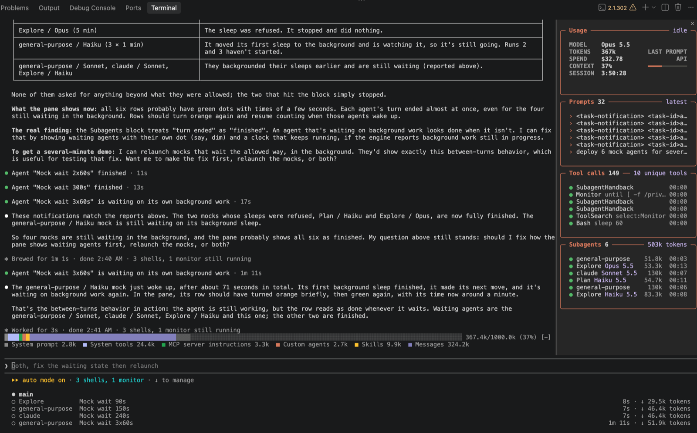
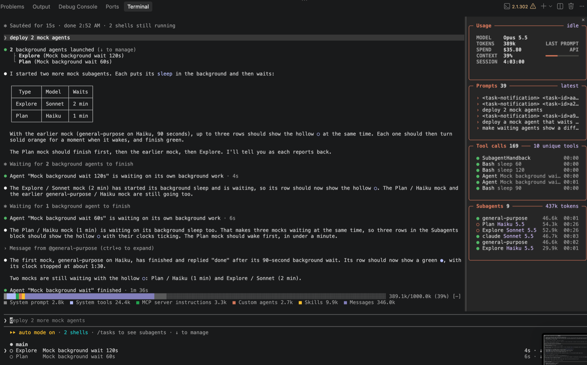
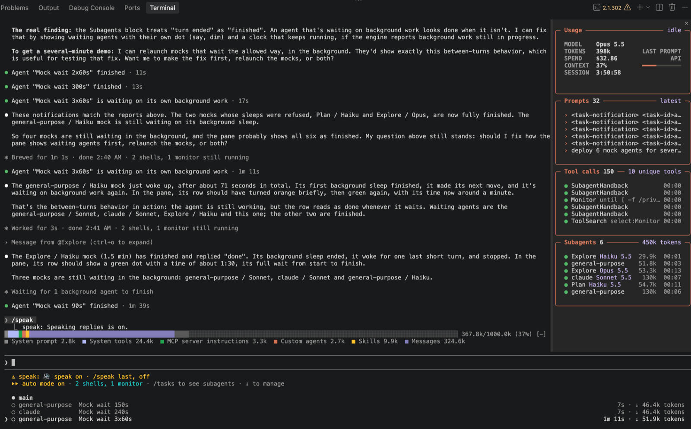

# claude-code-mods

A collection of [Claude Code](https://claude.com/claude-code) mods: small plugins that change Claude's own interface. Each mod installs on its own from this repository, which is a plugin marketplace.



| Mod | What it adds | Command | Platform |
| --- | --- | --- | --- |
| [`usage-pane`](plugins/usage-pane) | A live pane beside the chat: tokens, API-equivalent spend, context fill, recent prompts, tool calls and subagents | `/usage-pane` | any |
| [`context-bar`](plugins/context-bar) | A stacked context-window bar above the prompt, one color per `/context` category | `/context-bar` | any |
| [`speak`](plugins/speak) | Reads Claude's final reply aloud, picking a voice by language | `/speak` | macOS |

## Install

In a Claude Code terminal session, add the marketplace and install what you want:

```
/plugin install usage-pane --marketplace mattsebastianh/claude-code-mods
/plugin install context-bar --marketplace mattsebastianh/claude-code-mods
/plugin install speak --marketplace mattsebastianh/claude-code-mods
```

Answer `y` to "Add marketplace?", then pick a scope (user scope keeps the mod in every session). From a shell:

```
claude plugin install usage-pane --marketplace mattsebastianh/claude-code-mods
```

In the desktop app, where `/plugin` doesn't run: click **+** next to the prompt box, then **Plugins**, **Add marketplace** with `mattsebastianh/claude-code-mods`, then **Add plugin**.

Each mod is a hooks-only plugin: once installed it is active in that session with no reload.

### Try it without installing

```
git clone https://github.com/mattsebastianh/claude-code-mods
claude --plugin-dir ./claude-code-mods/plugins/usage-pane
```

Repeat `--plugin-dir` to load several.

## Demos

| Usage pane tracking subagents | `/speak` status |
| --- | --- |
|  |  |

<!-- TODO(before publish): add screen-recording links (upload the .mov files as GitHub release assets or drag them into this file on github.com). -->

## Compatibility

Developed and tested against Claude Code `2.1.302`. Mods use the plugin-authoring hooks API, which is still evolving; if a mod misbehaves on a newer build, please [open an issue](../../issues) with the version.

## Repository layout

```
.claude-plugin/marketplace.json   the marketplace listing every mod
plugins/<mod>/                    one self-contained plugin per folder
  .claude-plugin/plugin.json      manifest
  hooks/hooks.json                points at the hooks module
  hooks/register.ts(x)            the mod
  README.md  LICENSE
docs/                             screenshots and the release plan
```

## Contributing

See [CONTRIBUTING.md](CONTRIBUTING.md). Changes are tracked in [CHANGELOG.md](CHANGELOG.md).

## License

[MIT](LICENSE)
