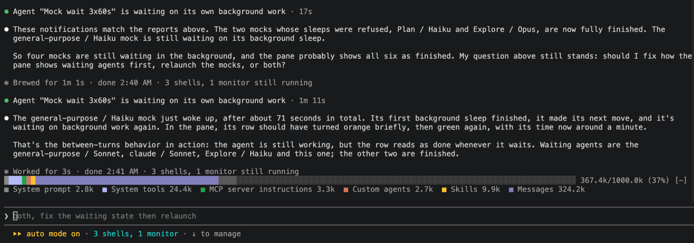

# context-bar

[](../../README.md#claude-code-mods)
[](LICENSE)

A stacked context-window bar above the prompt, one color per category of the `/context` breakdown (system prompt, system tools, MCP instructions, custom agents, skills, messages), with a legend and the total against your window size.



## Install

```
/plugin install context-bar --marketplace lambdamax/claude-code-mods
```

## Use

`/context-bar` toggles the bar. It refreshes after every prompt and every finished turn, and draws nothing until the first breakdown exists.

## Develop

```
claude plugin validate .
claude plugin test .
```

[MIT](LICENSE)
