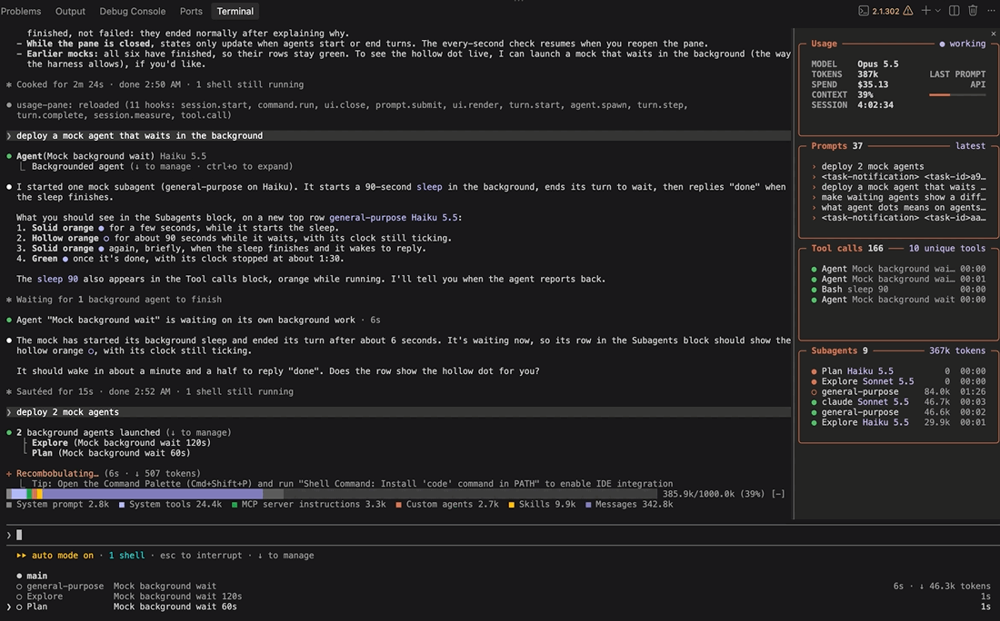
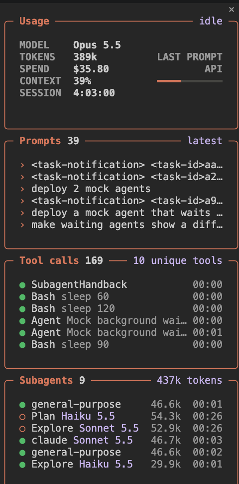

# usage-pane

[](../../README.md#claude-code-mods)
[](LICENSE)

A live usage pane beside the chat. It shows, updating as you work:

- **Usage**: model, tokens of the last prompt, API-equivalent spend, context fill, session clock
- **Prompts**: the latest prompts; select one to scroll the transcript to it
- **Tool calls**: running and recent calls with how long each took
- **Subagents**: every subagent with its model, tokens and clock; agents waiting on background work show a hollow dot and keep their clock running





## Install

```
/plugin install usage-pane --marketplace lambdamax/claude-code-mods
```

## Use

`/usage-pane` toggles the pane. It starts closed in every new session. It docks beside the transcript in fullscreen layouts and sits above the prompt otherwise.

## Notes

- Spend is the *API-equivalent* price of the tokens used, not what a subscription plan bills.
- The pane keeps its state in the session (`$.state`); nothing is written to disk and nothing leaves your machine.

## Develop

```
claude plugin validate .
claude plugin test .
```

[MIT](LICENSE)
